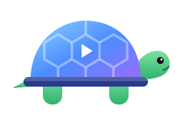
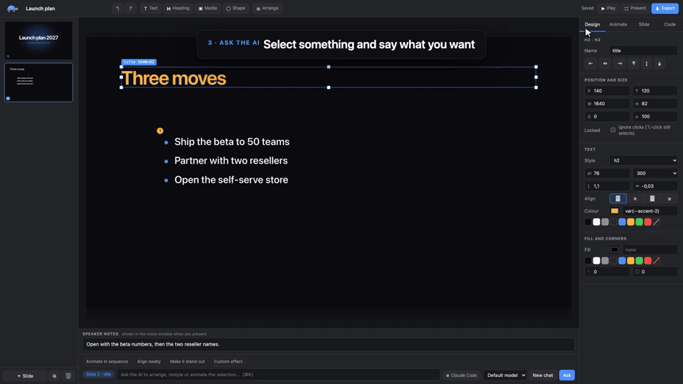
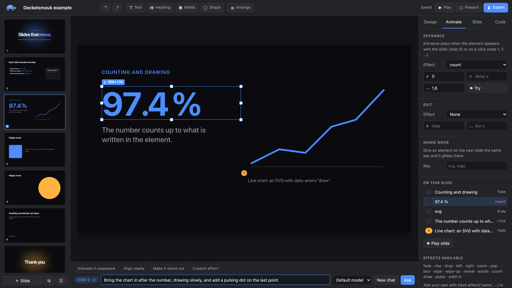

<p align="center">
  
</p>

<h1 align="center">Deckelsmouk</h1>

<p align="center">
  <b>Presentations that move like a keynote, edit like PowerPoint, and do what you tell them.</b><br>
  Arrange by mouse. Animate by asking. Ship one HTML file.
</p>

<p align="center">
  
  
  
  
  
  
</p>

<p align="center">
  <a href="docs/deckelsmouk-demo.mp4"></a>
</p>

<p align="center">
  <a href="docs/deckelsmouk-demo.mp4"><b>▶ Watch the full 90-second demo</b></a>: edit by hand, ask the AI, play, export.
</p>

<p align="center">
  
</p>

---

## Your slides deserve better than a slide tool

Slide software gives you a timeline of fades and flies. Your browser gives you **everything**: SVG that draws itself,
numbers that count up, canvases full of particles, real typography, real video, real code. What it never gave you
was a way to *work* with it: dragging a box two pixels left meant editing a style attribute and refreshing.

**Deckelsmouk closes that gap.** Your deck is plain HTML and JavaScript you own. On top of it sits a visual editor
you already know how to use, and next to that a prompt bar connected to **Claude Code**. Select three boxes and type
*"bring these in one per click, the chart last, drawing itself"*. A few seconds later it's done, in clean code you
can read, and **⌘Z** takes it back if you don't like it.

When the talk is ready, one command turns it into **a single HTML file**. No app, no account, no internet, no
"which version of Keynote do you have". Email it, put it on a USB stick, open it in ten years.

## Why people switch

<table>
<tr>
<td width="50%" valign="top">

### 🎯 Precise when you want it
Drag, resize and lasso. Smart guides snap to edges and centres. Nudge by the pixel, align, distribute, change
layer order. Double-click to edit text right on the slide. Drop images and videos straight in.

</td>
<td width="50%" valign="top">

### 💬 Effortless when you don't
Select anything and ask. Claude sees exactly what you see: the slide, your selection, every object's position.
It arranges, restyles, writes new animations and adds slides. Its changes appear live and come out as **one undo
step**.

</td>
</tr>
<tr>
<td valign="top">

### ✨ Motion that looks expensive
Word-by-word headlines, counting numbers, self-drawing charts, Keynote-style **magic move**, click-by-click builds,
exits and transitions. When that isn't enough, script anything JavaScript can draw.

</td>
<td valign="top">

### 📦 One file, forever
`npm run build` inlines slides, styles, fonts, images, video and animations into **one self-contained HTML file**
that plays offline in any browser. It can even be unpacked back into an editable deck.

</td>
</tr>
<tr>
<td valign="top">

### 🧑‍💻 Code you can read
No framework magic and no binary format. A deck is `deck.html` (slides, clearly marked) and `animations.js`
(effects with names). Diff it, review it, put it in git, edit it in VS Code. The editor picks up your changes live.

</td>
<td valign="top">

### 🎤 Ready for the stage
Hit **Present** and your speaker notes open in their own window: current and next slide (at the exact click step),
notes you can still edit during rehearsal, a timer and a clock. Clicker support, black screen, pause. Print to PDF for
the handout.

</td>
</tr>
</table>

## Start in 60 seconds

```bash
git clone https://github.com/BenBausch/Deckelsmouk.git
cd Deckelsmouk
npm run dev
```

That's it, with **no `npm install`**. The editor opens at `http://localhost:4800`. Open the **example** deck for a
tour of every feature, or create your own from the start page.

For the prompt bar, the default is the [Claude Code](https://claude.com/claude-code) CLI. If you're not signed in yet,
click the provider chip next to the prompt and **Sign in with your Claude account**; it opens the normal browser
sign-in. Prefer the Anthropic API or a local model? See [Bring your own model](#bring-your-own-model). Run
`npm install` once if you use the Anthropic API provider or the test suite.

## Talk to your slides

Select something, or nothing to mean the whole slide, and just say it:

> *"Animate these in one per click, the chart last with a slow draw."*
> *"Tidy this slide: align the left edges and give it more air."*
> *"Write an effect where the logo assembles from four pieces, and use it here."*
> *"Add a slide after this one comparing the three options as cards."*
> *"Make the number pop, use the accent colour, and pulse it once at the end."*

Under the hood the editor hands Claude Code the deck, the current slide, and every selected object with its HTML,
selector and exact box in stage pixels. Claude follows the house rules in [`CLAUDE.md`](CLAUDE.md), may only read and
edit files and syntax-check JavaScript (no other commands), and you watch each step stream by. Follow-ups keep the conversation (*"slower"*, *"now the
other two too"*). Pick Opus, Sonnet or Haiku per request.

Prefer the terminal? Run `claude` in the repo and work on any deck directly; the open editor updates as files change.

## Bring your own model

The prompt bar works with the model you already have. Click the provider chip next to it to switch, sign in or
add a key:

| Provider | Speaks | Sign-in | Good for |
|---|---|---|---|
| **Claude Code** (default) | Claude Code CLI, as an agent | your Claude account, from inside the editor | the best results: it edits the files itself, writes new effects, several slides at once |
| **Anthropic API** | Messages API, official SDK | API key (or `ANTHROPIC_API_KEY`, or an `ant auth login` profile) | Claude without the CLI, billed per use |
| **Ollama** | Ollama's native API | none locally, a key for remote/cloud servers | fully offline, private decks |
| **LM Studio** | OpenAI chat-completions | optional API token | local models with a friendly app |
| **OpenAI-compatible** | OpenAI chat-completions | API key | OpenAI, OpenRouter, Groq, vLLM, llama.cpp … |

Chat models can't touch files, so they answer in a strict edit format: whole slides, theme CSS and named effects. The
editor checks every block before applying it. A slide must stay a slide, speaker notes the model forgot are kept,
JavaScript is syntax-checked before it lands in `animations.js`, and anything invalid is skipped with a reason. The
whole answer is still **one ⌘Z**. Keys and tokens are stored on your computer in `~/.config/deckelsmouk/config.json`
(readable only by you), never in the repository, and never sent back to the browser.

Tip for local models: bigger is better at following the edit format. For Ollama the editor sends a 16k context length
by default (adjustable). In LM Studio, load the model with 16k or more.

## How it compares

| | PowerPoint / Keynote | HTML frameworks | Hand-written HTML | **Deckelsmouk** |
|---|:---:|:---:|:---:|:---:|
| Visual drag-and-drop editing | ✅ | ❌ | ❌ | ✅ |
| Animation beyond the preset list | ❌ | ⚠️ | ✅ | ✅ |
| Ask an AI to arrange and animate the selection | ⚠️ | ❌ | ❌ | ✅ |
| Runs with local models, fully offline | ❌ | ⚠️ | ✅ | ✅ |
| Readable, diffable source in git | ❌ | ✅ | ✅ | ✅ |
| One portable file, plays offline anywhere | ❌ | ⚠️ | ⚠️ | ✅ |
| Zero install, zero dependencies | ❌ | ❌ | ✅ | ✅ |

## How it works

```
┌──────────── decks/my-talk/ ────────────┐        npm run build        ┌──── dist/my-talk.html ─────┐
│ deck.html       slides + theme         │  ────────────────────────▶  │ one file, everything inside │
│ animations.js   named effects, scripts │                             │ slides · player ·           │
│ assets/         images, video, fonts   │                             │ animations at the bottom    │
└────────────────────────────────────────┘                             └─────────────────────────────┘
          ▲                    ▲
   visual editor      Claude Code (prompt bar or terminal)
```

The source files are the single source of truth. The editor, Claude and your text editor all write to the same files,
and everything stays in sync.

### A slide is just HTML

```html
<!-- ===== Slide 2 · agenda ===== -->
<section class="slide" id="agenda" data-title="Agenda">
  <h2 class="h2" data-anim="rise" style="position:absolute;left:140px;top:120px;width:1200px">Three things</h2>
  <ul class="list" style="position:absolute;left:140px;top:330px;width:1100px">
    <li data-anim="left" data-step="1">First</li>
    <li data-anim="left" data-step="2">Second</li>
  </ul>
  <aside class="notes"><p>Speaker notes.</p></aside>
</section>
```

### Animation is one attribute away

| Attribute | |
|---|---|
| `data-anim="rise"` | entrance effect |
| `data-step="2"` | appears on the 2nd click (absent: with the slide) |
| `data-delay="0.3"` `data-dur="1.2"` | timing in seconds |
| `data-out="fade"` `data-out-step="3"` | exit |
| `data-magic="logo"` | glides to the element with the same key on the next slide |

**Built-in effects:** `fade` `rise` `drop` `left` `right` `zoom` `pop` `blur` `wipe` `wipe-up` `reveal` `words` `count`
`draw` `pulse`.

### Anything more is code with a name

```js
/* ===== Effects ===== */

// Swings in from below with a slight turn. Use it anywhere: data-anim="swing".
Deck.effect('swing', { from: { opacity: 0, rotate: '-8deg', translate: '0 60px' }, dur: 1100 });

/* ===== Slide scripts ===== */

// Slide "orbit": particles on a canvas; the first click speeds them up.
Deck.slide('orbit', {
  enter(ctx) { ctx.loop((t, dt) => { /* draw a frame */ }); },
  step(n, ctx) { /* react to clicks */ },
});
```

Slide scripts get a small, safe context: loops and timers clean up when you leave the slide and freeze when you press
**K**. The full reference is in [`CLAUDE.md`](CLAUDE.md), so humans and Claude follow the same rules.

<details>
<summary><b>Editor shortcuts</b></summary>

| Key | Action |
|---|---|
| Click / click again | select an object / go one level inside it |
| ⌥-click | select the exact element under the pointer |
| ⇧-click, drag on empty space | add to selection, lasso |
| Double-click, Enter | edit text (Esc to finish) |
| Arrows, ⇧ Arrows | nudge 1 px / 10 px (with nothing selected, ↑ ↓ change slides) |
| ⌥-drag, ⇧-drag | move without snapping, move in a straight line |
| ⌘C ⌘X ⌘V ⌘D | copy, cut, paste, duplicate |
| ⌫ | delete selection (in the slide list: delete slide) |
| ⌘Z, ⇧⌘Z | undo, redo, including Claude's changes |
| ⌘K | jump to the prompt bar |
| ⌘Enter | play the current slide (Esc closes) |
| T | new text box |

</details>

## Speaker notes, where you need them

Type notes for each slide in the notes field under the slide, just like in PowerPoint. Bold, italics and paragraphs
are kept. Click **Present** and two windows open: the deck (drag it to the projector and press **F**) and a separate
**notes window** for your laptop, showing:

- the current slide exactly as the audience sees it at this click, and what comes next
- your notes, in a size you choose (A− / A+). While rehearsing you can **edit them right there**, and they're saved
  into the deck.
- elapsed time, the clock, and buttons for next, back, pause and black screen. The arrow keys and your clicker work
  in this window too.

When you close the presentation, the notes window closes with it. Reloading the deck mid-rehearsal doesn't count; the
notes window stays and picks up where the deck is. From a built single file, press **P** to open the same notes window
(read-only, since there's no server to save to).

<details>
<summary><b>Presenting</b></summary>

Open the built `dist/<deck>.html` in any browser, or click **Present** in the editor (it opens your notes window too;
if your browser blocks pop-ups, the first click or key opens it).

| Key | Action |
|---|---|
| → Space PageDown Enter, click | next step |
| ← PageUp Backspace | back (shows the previous state instantly) |
| Home / End | first slide / last main slide (backup slides come after End) |
| F | fullscreen |
| P | notes window: current and next slide, notes, timer, controls |
| K | pause / resume all motion |
| B | black screen |

The URL keeps your place (`#3.1` = slide 3, step 1; `#intro` works too). Add `?print` for every slide in its final
state, ready for **Print → Save as PDF**, or `?static` to turn off motion for screenshots.

</details>

<details>
<summary><b>Commands and settings</b></summary>

```bash
npm run dev                          # editor + live reload (http://localhost:4800); `npm start` without opening a browser
npm run build                        # every deck → dist/<deck>.html  (or: npm run build -- my-talk)
npm run new -- my-talk "My Talk"     # new deck from templates/default
npm run unpack -- talk.html my-talk  # a built single file back into an editable deck
npm test                             # end-to-end checks of every feature (Playwright; run npm install once)
```

Environment: `PORT`, `DECK_CLAUDE_MODEL` (default Claude Code model), `DECK_CLAUDE_BIN` (path to `claude`),
`DECKELSMOUK_CONFIG` (where AI settings and keys are stored), `ANTHROPIC_API_KEY` / `OPENAI_API_KEY` (used when no key is saved).

</details>

<details>
<summary><b>Repository layout</b></summary>

```
decks/<name>/        your presentations (deck.html, animations.js, assets/)
templates/default/   the starting point for new decks; add your own themes as more folders
runtime/             the player shared by all decks; inlined into every build
editor/              the visual editor (plain ES modules, no build step)
tools/               dev server, build, new, unpack (Node, no dependencies)
tests/               end-to-end suite (Playwright, dev-only)
docs/                logo and screenshots
dist/                built single-file decks (git-ignored by default)
CLAUDE.md            deck format and animation API, for Claude and for you
```

</details>

## Tested, end to end

`npm test` drives a real browser through **every feature**: building and unpacking, each animation type, click steps
and exits, magic move, slide scripts and pause, presenter sync and notes editing, every editor tool from drag and snap
to undo, the slide list, live reload, export, Claude Code sign-in, and every AI provider: Claude Code (stand-in CLI),
LM Studio/OpenAI, Ollama and the Anthropic SDK (against a local mock server that speaks each format), so it's free and
repeatable. `REAL_CLAUDE=1 npm test` adds one real call.

## Bring your old decks

Have a folder of HTML talks from before? Ask Claude Code in this repo:

> *"Convert ~/talks/old-pitch/index.html into a deck called old-pitch."*

The conversion recipe is in `CLAUDE.md`. From then on, the old deck has an editor too.

## Good to know

- The editor shows each slide fully built so you can reach every element; press **Play** (⌘Enter) to see the motion.
  Script-driven canvases come alive there.
- Dragging an element out of a layout (a list item, a flex child) offsets it from its place in that layout. Top-level
  objects are positioned freely, like in PowerPoint.
- The dev server listens on `127.0.0.1` only and refuses cross-site requests, since it can start Claude Code.
- Everything is inlined, so long videos make big files. That's the price of a deck that works anywhere.

## Why a turtle?

*Deckelsmouk* is Luxembourgish for **turtle**: a creature that carries its whole home on its back. So does every deck
you build here: one file with everything inside, ready to go wherever you are. Unlike its namesake, it's fast.

<p align="center"></p>
